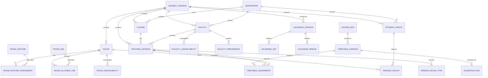
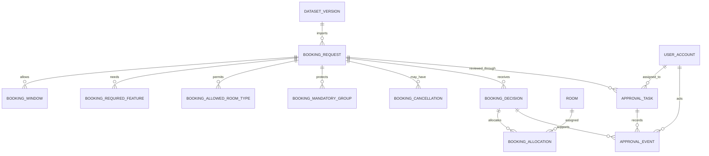
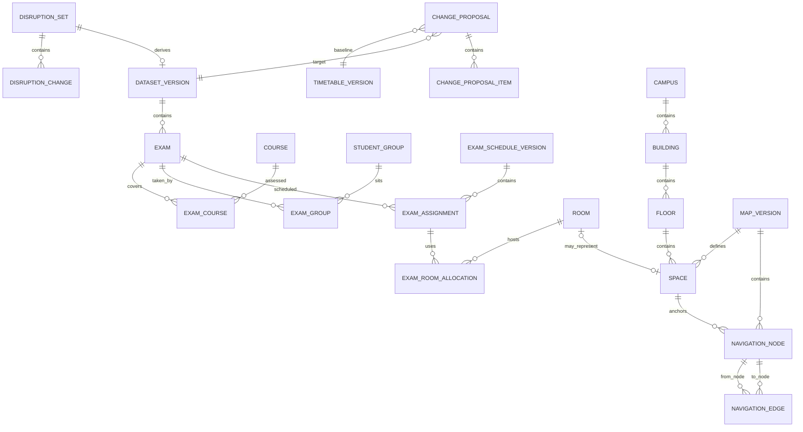

# CIT Campus Scheduling & Venue Management Platform
# ER Diagram & PostgreSQL Relational Schema Design — v0.1

**Status:** Proposed design for review; not frozen  
**Depends on:** `CIT_Source_Audit_Data_Dictionary_v0_1`  
**Competition source:** CrunchWeek Starter Pack, dataset `cit-public-v1`  
**Database target:** PostgreSQL; PostGIS extension for Campus Navigator  
**Architecture target:** Modular monolith with explicit module boundaries

> **Design authority:** The official starter-pack JSON and `validator.py` define the competition contract. This document proposes a normalized internal relational model. It does not change the external JSON contract. Any additional application policy is labelled as such.

---

## 1. Purpose and design principles

This document converts the source data dictionary into a proposed relational model. It is intended to be reviewed before migrations or application code are generated.

### Core principles

1. **Preserve the competition contract.** Import from `cit_public.json`; export the exact required JSON shape.
2. **Separate source facts from operational records.** Imported source data, generated schedules, decisions, approvals and user actions have different lifecycles.
3. **Version immutable outputs.** A generated timetable, an approved repair and a published map must be traceable and reproducible.
4. **Normalize relationships.** Arrays representing references become join tables; repeated time periods become child records.
5. **Keep the solver deterministic and auditable.** Store solver inputs, version, objective metrics and validation results.
6. **Enforce hard constraints twice where appropriate.** Validate in application/domain logic and use database constraints for integrity and concurrency safety. Database constraints cannot replace the scheduling validator.
7. **Keep AI outside the authority boundary.** AI creates drafts/proposals; backend services validate and authorised users approve.
8. **Use a modular monolith.** Separate modules in code and schemas logically; do not introduce microservices for the hackathon MVP.
9. **Do not over-normalize small static vocabularies prematurely.** Use lookup tables for configurable categories, and CHECK constraints or validated strings for stable enums.
10. **No destructive edits to historical data.** Changes create new versions or append-only events.

## 2. Schema namespace strategy

Recommended PostgreSQL schemas:

| PostgreSQL schema | Responsibility |
|---|---|
| `core` | Dataset versions, institution, departments, users, roles, audit |
| `academic` | Rooms, faculty, groups, courses, sessions, unavailability |
| `scheduling` | Timetable versions, assignments, solver runs, validation |
| `booking` | Requests, windows, decisions, allocations, approvals |
| `exams` | Exam definitions and exam schedule allocations |
| `change_mgmt` | Disruptions, change proposals, approvals, applied changes |
| `navigation` | Campus, buildings, floors, spaces, map versions, graph |
| `assistant` | AI conversations, messages, tool executions |
| `integration` | Imports, exports, source artifacts and validator runs |

For a small team, these may be implemented in one PostgreSQL database and one FastAPI deployment. PostgreSQL schemas provide logical separation, not separate services.

## 3. ER diagram — core academic and scheduling model



## 4. ER diagram — bookings and approval



## 5. ER diagram — exams, disruption and campus navigation



The diagrams are conceptual. The table definitions below are the authoritative proposed model; cardinalities and optionality are clarified there.

---

## 6. Common conventions

### 6.1 Primary keys and external IDs
- Internal primary keys: UUID, generated by the database/application.
- External source identifiers: retain exact source IDs in `external_id` or explicit source-code columns.
- Every imported entity should be scoped to `dataset_version_id` where it represents a dataset snapshot.
- Use unique `(dataset_version_id, external_id)` constraints.
- Do not assume external IDs are globally unique across future datasets.

### 6.2 Timestamps
Use `timestamptz` for submitted, created, updated, decided, imported and exported timestamps. The source booking timestamp includes an explicit `+05:30` offset. Preserve the instant; store source text only if exact textual round-trip is required.

### 6.3 Time slots
- Teaching schedule: `day_code` + `start_period_id` + `duration_periods`.
- Booking: day + inclusive start/end period within one requested window.
- Exam schedule: day + exam session code (`AM`/`PM`).
- Do not use one generic period table for all three domains.
- The calendar table records source period IDs and clock boundaries. A teaching assignment stores the start period; its occupied periods are derived from duration and validated against calendar rules.

### 6.4 Arrays
Convert reference arrays into join tables:
- session groups;
- session allowed room types;
- booking windows;
- booking required features;
- booking allowed room types;
- booking mandatory groups;
- exam courses;
- exam groups;
- exam room allocations.
Keep JSONB only for raw payloads, flexible AI metadata, or immutable source snapshots—not as the primary representation of relationships.

### 6.5 Deletion policy
- Imported dataset records: immutable within a dataset version.
- Operational records: use status/archival fields and append-only history.
- Avoid cascading deletes from master data into historical timetable or approval records.
- Prefer `ON DELETE RESTRICT` for referenced master data; use explicit retention policy for accounts and logs.

---

## 7. Core and configuration tables

### 7.1 `core.dataset_versions`

| Column | Type | Rules | Purpose |
|---|---|---|---|
| `id` | uuid PK | generated | Internal dataset version ID |
| `external_dataset_id` | text | NOT NULL | e.g. `cit-public-v1` |
| `version_label` | text | NOT NULL | Human-readable import/derived label |
| `parent_dataset_version_id` | uuid FK nullable | self-reference | Original version for derived datasets |
| `source_sha256` | char(64) | nullable | Source file checksum |
| `source_filename` | text | nullable | Imported filename |
| `status` | text | CHECK: importing/active/derived/archived/failed | Lifecycle |
| `source_payload` | jsonb | NOT NULL for source import | Immutable original JSON snapshot |
| `imported_at` | timestamptz | NOT NULL | Import time |
| `imported_by` | uuid FK nullable | user/system | Actor |
| `created_at` | timestamptz | NOT NULL | Audit |

**Constraints:** unique `(external_dataset_id, source_sha256)` where checksum is not null; only one active dataset version per competition environment may be selected by application policy, not necessarily a global DB uniqueness rule.

### 7.2 `core.institutes`

`id uuid PK`, `code text UNIQUE NOT NULL`, `name text NOT NULL`, `timezone text NOT NULL`, `is_active boolean NOT NULL DEFAULT true`, timestamps.

The source `institute` value is imported as metadata. Do not invent a multi-campus hierarchy unless product scope needs it.

### 7.3 `core.departments`

`id uuid PK`, `code text NOT NULL`, `name text NOT NULL`, `institute_id uuid FK`, `dataset_version_id uuid FK nullable`, `external_code text nullable`, `is_active boolean`.

Unique `(institute_id, code)` for operational departments; unique `(dataset_version_id, external_code)` for imported department codes if departments are materialized per dataset. A department master table may be shared across datasets if codes are stable; retain source codes on imported records.

### 7.4 Calendar configuration

Tables:
- `core.calendar_versions(id, dataset_version_id, label, fest_week_label, is_active, created_at)`
- `core.calendar_days(id, calendar_version_id, day_code, ordinal, is_teaching_day)`
- `core.calendar_periods(id, calendar_version_id, period_number, start_time, end_time, is_teaching_period)`
- `core.calendar_breaks(id, calendar_version_id, break_code, after_period_number, start_time, end_time)`
- `core.calendar_lab_start_periods(calendar_version_id, period_number)`
- `core.calendar_event_periods(calendar_version_id, period_number)`
- `core.calendar_exam_days(calendar_version_id, day_code, ordinal)`
- `core.calendar_exam_sessions(id, calendar_version_id, session_code, start_time, end_time)`

**Constraints:** unique day code per calendar; unique period number per calendar; unique exam session code per calendar; start_time < end_time; referenced periods must belong to same calendar version. The source has a teaching calendar MON–FRI, event-only periods 10–13 and exam calendar MON–SAT with AM/PM sessions.

### 7.5 Booking priority configuration

- `booking.priority_categories(id, code UNIQUE, display_name, sort_rank, validator_weight)`
- `booking.role_category_caps(id, dataset_version_id, role_code, max_category_id FK)`

`sort_rank` is derived from source `priority_order`. `validator_weight` mirrors validator `CAT_WEIGHT` values exactly for the competition validator. Do not assume sort rank and numeric validator weight are interchangeable. Unique `(dataset_version_id, role_code)`.

---

## 8. Academic master data tables

### 8.1 `academic.rooms`

| Column | Type | Rules |
|---|---|---|
| `id` | uuid PK | internal key |
| `dataset_version_id` | uuid FK | required |
| `external_id` | text | required, source room code |
| `name` | text | required |
| `building_label` | text | required source text |
| `room_type_code` | text | required |
| `capacity` | integer | CHECK >= 0 |
| `accessible` | boolean | required |
| `source_payload` | jsonb | optional immutable source record |

Unique `(dataset_version_id, external_id)`. `building_label` remains source text until a verified building/map import is available. Do not fabricate building IDs from labels.

### 8.2 Room feature catalog and assignments
- `academic.room_features(id, code UNIQUE, display_name)`
- `academic.room_feature_assignments(room_id FK, feature_id FK, PRIMARY KEY(room_id, feature_id))`
- `academic.room_allowed_uses(room_id FK, use_code, PRIMARY KEY(room_id, use_code))`

Feature codes preserve source values such as `projector`, `stage`, `pa_system`, `ac`. `accessible` is a dedicated room boolean in the source; booking validation may interpret requested need `accessible` against this boolean. Do not duplicate it as a feature unless a consistent mapping layer is required.

### 8.3 `academic.faculty`

`id uuid PK`, `dataset_version_id FK`, `external_id text`, `name text`, `department_code text`, `department_id uuid FK nullable`, `max_hours_per_day integer CHECK > 0`, `needs_accessible boolean`, `source_payload jsonb`.

Unique `(dataset_version_id, external_id)`. Keep `department_code` even if normalized department reference is unresolved.

### 8.4 `academic.faculty_unavailability`

`id uuid PK`, `faculty_id uuid FK`, `day_code text`, `period_number integer`, `reason text`, `source_group_key text nullable`, `dataset_version_id uuid FK`.

One row per unavailable day/period pair. Unique `(faculty_id, day_code, period_number, source_group_key)` where practical. Source object groups periods in an array; importer expands it. `source_group_key` allows reconstructing original grouping if round-trip fidelity is required.

### 8.5 `academic.faculty_preferences`

`id uuid PK`, `faculty_id uuid FK`, `preference_type text`, `note text`, `source_payload jsonb`.

### 8.6 `academic.faculty_preference_slots`

`preference_id uuid FK`, `day_code text`, `period_number integer`, composite PK. For `avoid`, each occupied matching hour adds S1 penalty 2. Preserve unknown preference types in source payload and flag them for review rather than dropping them.

### 8.7 `academic.student_groups`

`id uuid PK`, `dataset_version_id FK`, `external_id text`, `name text`, `year integer CHECK > 0`, `department_code text`, `department_id uuid FK nullable`, `size integer CHECK >= 0`, `needs_accessible boolean`, `source_payload jsonb`.

Unique `(dataset_version_id, external_id)`.

### 8.8 `academic.courses`

`id uuid PK`, `dataset_version_id FK`, `external_id text`, `title text`, `department_code text`, `department_id uuid FK nullable`, `year integer`, `lecture_hours integer CHECK >= 0`, `tutorial_hours integer CHECK >= 0`, `lab_blocks integer CHECK >= 0`, `source_payload jsonb`.

Unique `(dataset_version_id, external_id)`.

### 8.9 `academic.teaching_sessions`

`id uuid PK`, `dataset_version_id FK`, `external_id text`, `course_id uuid FK`, `faculty_id uuid FK`, `kind text CHECK IN ('lecture','tutorial','lab')`, `size integer CHECK >= 0`, `duration_periods integer CHECK > 0`, `needs_accessible boolean`, `basket_slot text nullable`, `fixed_day_code text nullable`, `fixed_start_period integer nullable`, `source_payload jsonb`.

Unique `(dataset_version_id, external_id)`. Enforce fixed day/start both null or both non-null. Fixed-slot period/day must belong to the dataset calendar. The external source field `fixed_slot` is an object; normalize it to two columns while preserving the original payload.

### 8.10 Session relationship tables
- `academic.session_groups(session_id FK, student_group_id FK, PRIMARY KEY(session_id, student_group_id))`
- `academic.session_allowed_room_types(session_id FK, room_type_code, PRIMARY KEY(session_id, room_type_code))`

A session must have at least one group and one allowed room type. Enforce via import/domain validation; a normal SQL CHECK cannot check child-row existence.

### 8.11 `academic.room_unavailability`

`id uuid PK`, `room_id uuid FK`, `day_code text`, `period_number integer`, `reason text`, `source_group_key text nullable`, `dataset_version_id uuid FK`.

Expand source period arrays into one row per period. Unique `(room_id, day_code, period_number, source_group_key)` where practical.

---

## 9. Scheduling tables

### 9.1 `scheduling.timetable_versions`

`id uuid PK`, `dataset_version_id uuid FK`, `version_number integer`, `status text CHECK IN ('draft','generated','validated','approved','published','superseded','failed')`, `parent_timetable_version_id uuid FK nullable`, `solver_run_id uuid FK nullable`, `created_by uuid FK nullable`, `created_at timestamptz`, `approved_by uuid FK nullable`, `approved_at timestamptz nullable`, `notes text nullable`.

Unique `(dataset_version_id, version_number)`. A published timetable is immutable; changes create a child version.

### 9.2 `scheduling.timetable_assignments`

`id uuid PK`, `timetable_version_id uuid FK`, `session_id uuid FK`, `day_code text`, `start_period integer`, `room_id uuid FK`, `created_at timestamptz`.

Unique `(timetable_version_id, session_id)` guarantees at most one assignment per session per timetable version. This does not guarantee every source session is assigned; completeness is a validation rule. Add indexes on `(timetable_version_id, day_code, start_period)`, `(timetable_version_id, room_id, day_code)`, `(timetable_version_id, session_id)`.

**Do not create a simple unique key on room/day/start period alone** because a multi-period session occupies multiple periods and the conflict is an interval overlap. Use solver/domain validation and, if desired, a derived occupancy table or PostgreSQL range exclusion constraint.

### 9.3 Optional derived occupancy table

`scheduling.assignment_occupancy(id uuid PK, timetable_assignment_id uuid FK, resource_type text, resource_key text, day_code text, period_number integer)`

One row per occupied period and resource (`room`, `faculty`, `student_group`). Unique `(timetable_assignment_id, resource_type, resource_key, day_code, period_number)`. A unique constraint on `(timetable_version_id, resource_type, resource_key, day_code, period_number)` prevents overlap, but requires carrying `timetable_version_id` into this table and enforcing transactionally. Basket sessions need a special occupancy key for groups: all sessions sharing one `basket_slot` use the same synthetic basket occupancy key rather than the actual group keys for that same basket period; all other sessions still conflict with those groups. This logic should be built by a tested scheduling occupancy service, not a fragile trigger.

### 9.4 `scheduling.solver_runs`

`id uuid PK`, `dataset_version_id uuid FK`, `input_timetable_version_id uuid FK nullable`, `output_timetable_version_id uuid FK nullable`, `solver_name text`, `solver_version text`, `model_version text`, `status text`, `started_at timestamptz`, `completed_at timestamptz nullable`, `time_limit_seconds integer nullable`, `random_seed integer nullable`, `objective_value numeric nullable`, `hard_violation_count integer nullable`, `soft_penalty_total numeric nullable`, `parameters jsonb`, `logs_uri text nullable`.

Store solver parameters and version to make results reproducible. Do not store secrets in `parameters`.

### 9.5 `scheduling.solver_metrics`
`id uuid PK`, `solver_run_id uuid FK`, `metric_code text`, `metric_value numeric`, `details jsonb nullable`. Examples: S1..S6, sessions moved, solve time, objective bound.

### 9.6 Validation tables
- `integration.validation_runs(id uuid PK, dataset_version_id uuid FK, timetable_version_id uuid FK nullable, export_job_id uuid FK nullable, validator_version text, status text, hard_violation_count integer, soft_penalty_total numeric, booking_score numeric nullable, priority_inversions integer nullable, report_json jsonb, created_at timestamptz)`
- `integration.validation_violations(id uuid PK, validation_run_id uuid FK, rule_code text, severity text, entity_external_id text nullable, message text, details jsonb nullable)`

Keep the raw validator JSON report, plus normalized violation rows for filtering.

---

## 10. Booking and approval tables

### 10.1 `booking.booking_requests`

`id uuid PK`, `dataset_version_id uuid FK nullable`, `external_id text nullable`, `requester_label text`, `requester_user_id uuid FK nullable`, `role_code text`, `department_code text nullable`, `department_id uuid FK nullable`, `requested_category_code text`, `effective_category_code text`, `title text`, `attendance integer CHECK >= 0`, `duration_periods integer CHECK > 0`, `requested_room_external_id text nullable`, `series_id text nullable`, `raw_text text`, `submitted_at timestamptz`, `status text`, `created_at timestamptz`, `updated_at timestamptz`.

Imported requests retain the source requester label and may have no authenticated account. `effective_category_code` is computed by the booking domain service using the imported cap configuration; do not trust a client-supplied effective category.

### 10.2 Booking child tables
- `booking.booking_windows(id uuid PK, booking_request_id uuid FK, day_code text, from_period integer, to_period integer)`; end is inclusive, from <= to.
- `booking.booking_allowed_room_types(booking_request_id uuid FK, room_type_code text, PK(...))`
- `booking.booking_required_features(booking_request_id uuid FK, feature_code text, PK(...))`
- `booking.booking_mandatory_groups(booking_request_id uuid FK, student_group_id uuid FK, PK(...))`
- `booking.booking_cancellations(id uuid PK, booking_request_id uuid FK, cancelled_at timestamptz, cancelled_by_label text, cancelled_by_user_id uuid FK nullable, note text)`

A cancellation is a separate event/record, not deletion of the request. The effective cancellation status blocks approval and alternative offers.

### 10.3 `booking.booking_decisions`

`id uuid PK`, `booking_request_id uuid FK`, `decision_version integer`, `status text CHECK IN ('approved','rejected','alternative_offered')`, `reason text`, `decided_by_user_id uuid FK nullable`, `decided_at timestamptz`, `is_effective boolean`, `export_batch_id uuid FK nullable`, `source_decision_payload jsonb nullable`.

Unique `(booking_request_id, decision_version)`. At most one effective decision per request should be enforced with a partial unique index on `booking_request_id WHERE is_effective = true`. Decision history is append-only; superseding a decision marks the former record non-effective within a transaction and creates a new decision.

### 10.4 `booking.booking_allocations`

`id uuid PK`, `booking_decision_id uuid FK`, `room_id uuid FK`, `day_code text`, `start_period integer`, `end_period integer`, `allocation_kind text CHECK IN ('requested_window','alternative')`.

The export requires one room per booking decision. The current competition contract does not describe multi-room booking allocations. If the product later supports multi-room bookings, this table can support multiple allocation rows, but the export adapter must follow organiser-approved semantics.

### 10.5 Approval workflow tables
- `booking.approval_tasks(id uuid PK, booking_request_id uuid FK, stage_code text, assigned_role_code text, assigned_user_id uuid FK nullable, status text, created_at timestamptz, due_at timestamptz nullable, completed_at timestamptz nullable)`
- `booking.approval_events(id uuid PK, approval_task_id uuid FK, actor_user_id uuid FK, action_code text, reason text, occurred_at timestamptz, metadata jsonb nullable)`

Enforce no-self-approval in the service layer by comparing authenticated requester identity and decision actor. Imported requests without requester account identity need an explicit reconciliation/policy path. Database trigger enforcement is optional and must not be the only safeguard.

**Open policy:** The source defines role-category caps and role labels, but not a full reviewer routing matrix. Reviewer routing by role/department/room owner must be confirmed with organisers or explicitly documented as an application proposal.

---

## 11. Examination tables

- `exams.exams(id uuid PK, dataset_version_id uuid FK, external_id text, size integer CHECK >= 0, duration_hours integer CHECK > 0, source_payload jsonb)`
- `exams.exam_courses(exam_id uuid FK, course_id uuid FK, PRIMARY KEY(exam_id, course_id))`
- `exams.exam_groups(exam_id uuid FK, student_group_id uuid FK, PRIMARY KEY(exam_id, student_group_id))`
- `exams.exam_schedule_versions(id uuid PK, dataset_version_id uuid FK, version_number integer, status text, parent_version_id uuid FK nullable, created_at timestamptz)`
- `exams.exam_assignments(id uuid PK, exam_schedule_version_id uuid FK, exam_id uuid FK, day_code text, exam_session_code text)`
- `exams.exam_room_allocations(exam_assignment_id uuid FK, room_id uuid FK, PRIMARY KEY(exam_assignment_id, room_id))`

Unique `(exam_schedule_version_id, exam_id)`; one exam is assigned at most once per version. Every source exam must appear exactly once in the final export. Room and group overlap are validated by exam slot. Capacity uses `floor(room.capacity / 2)` for each allocated room.

---

## 12. Disruption and change-management tables

### 12.1 `change_mgmt.disruption_sets`
`id uuid PK`, `external_change_id text nullable`, `source_dataset_id text`, `base_dataset_version_id uuid FK`, `derived_dataset_version_id uuid FK nullable`, `description text`, `status text CHECK IN ('draft','submitted','validated','approved','applied','rejected','failed')`, `submitted_by uuid FK nullable`, `approved_by uuid FK nullable`, timestamps, `source_payload jsonb`.

### 12.2 `change_mgmt.disruption_changes`
`id uuid PK`, `disruption_set_id uuid FK`, `sequence_number integer`, `change_type text`, `target_external_id text nullable`, `payload jsonb`, `reason text nullable`.

Keep the original change payload because each change type has a different shape. Domain validators must validate payload shape per `change_type`.

### 12.3 `change_mgmt.change_proposals`
`id uuid PK`, `disruption_set_id uuid FK nullable`, `baseline_timetable_version_id uuid FK`, `target_dataset_version_id uuid FK`, `proposed_timetable_version_id uuid FK nullable`, `status text`, `objective_value numeric nullable`, `sessions_moved integer nullable`, `hard_violation_count integer nullable`, `created_by uuid FK nullable`, `created_at timestamptz`.

### 12.4 `change_mgmt.change_proposal_items`
`id uuid PK`, `change_proposal_id uuid FK`, `session_id uuid FK nullable`, `change_kind text`, `before_assignment jsonb nullable`, `after_assignment jsonb nullable`, `explanation text nullable`.

This makes before/after comparison explainable. The canonical assignments remain in timetable version tables; JSON snapshots here are for compact audit/display, not the source of truth.

### 12.5 `change_mgmt.change_approvals`
`id uuid PK`, `change_proposal_id uuid FK`, `decision text`, `actor_user_id uuid FK`, `reason text`, `decided_at timestamptz`.

Apply only after explicit Admin approval as specified by the problem statement. Use a transaction to select the approved proposal, verify its baseline is still current or revalidate, and atomically activate the derived dataset/timetable version.

---

## 13. User, role, audit and notification tables

### 13.1 `core.user_accounts`
`id uuid PK`, `email citext UNIQUE NOT NULL`, `display_name text NOT NULL`, `password_hash text nullable`, `auth_provider text nullable`, `provider_subject text nullable`, `status text`, timestamps.

Use a managed identity provider if available; do not store plaintext passwords. Email uniqueness and case-insensitive comparison should be deliberate.

### 13.2 `core.role_assignments`
`id uuid PK`, `user_id uuid FK`, `role_code text`, `scope_type text`, `scope_id uuid nullable`, `valid_from timestamptz`, `valid_until timestamptz nullable`, `granted_by uuid FK nullable`.

Official competition roles: `admin`, `department_coordinator`, `faculty`, `club`. Student-facing read access can be implemented as a product access policy, but do not silently add a fifth competition role. Multiple scoped role assignments may be granted to one user.

### 13.3 `core.audit_logs`
`id uuid PK`, `actor_user_id uuid FK nullable`, `action_code text`, `entity_type text`, `entity_id uuid nullable`, `occurred_at timestamptz`, `request_id text nullable`, `before_state jsonb nullable`, `after_state jsonb nullable`, `metadata jsonb nullable`.

Append-only. Restrict access; redact secrets and sensitive personal information. Audit approval, publish, import, export, role changes, disruption application and overrides.

### 13.4 `core.notifications`
`id uuid PK`, `recipient_user_id uuid FK`, `event_code text`, `title text`, `body text`, `resource_type text nullable`, `resource_id uuid nullable`, `read_at timestamptz nullable`, `created_at timestamptz`.

Notifications are generated after successful transaction commit. They must not be the authoritative approval record.

---

## 14. Campus Navigator tables

Use PostGIS for outdoor geometries and a local coordinate system for indoor floor plans.

- `navigation.campuses(id uuid PK, institute_id uuid FK, code text, name text, timezone text)`
- `navigation.buildings(id uuid PK, campus_id uuid FK, code text, name text, outdoor_geometry geometry(Polygon,4326) nullable)`
- `navigation.floors(id uuid PK, building_id uuid FK, floor_code text, floor_label text, level_number integer, coordinate_system text, width_units numeric, height_units numeric)`
- `navigation.map_assets(id uuid PK, uploaded_by uuid FK, storage_uri text, media_type text, checksum text, source_type text, processing_status text, uploaded_at timestamptz)`
- `navigation.map_versions(id uuid PK, campus_id uuid FK, version_number integer, status text, parent_version_id uuid FK nullable, created_at timestamptz, approved_by uuid FK nullable, published_at timestamptz nullable)`
- `navigation.spaces(id uuid PK, map_version_id uuid FK, floor_id uuid FK, linked_room_id uuid FK nullable, space_type text, label text, geometry_local jsonb nullable, geometry_geographic geometry(Polygon,4326) nullable, is_public boolean)`
- `navigation.entrances(id uuid PK, map_version_id uuid FK, building_id uuid FK, space_id uuid FK nullable, outdoor_node_id uuid FK nullable, indoor_node_id uuid FK nullable, entrance_type text)`
- `navigation.navigation_nodes(id uuid PK, map_version_id uuid FK, floor_id uuid FK nullable, space_id uuid FK nullable, node_type text, x_local numeric nullable, y_local numeric nullable, location geography(Point,4326) nullable)`
- `navigation.navigation_edges(id uuid PK, map_version_id uuid FK, from_node_id uuid FK, to_node_id uuid FK, edge_type text, distance_m numeric, accessible boolean, directionality text, geometry_local jsonb nullable, geometry_geographic geometry(LineString,4326) nullable)`
- `navigation.map_processing_jobs(id uuid PK, map_asset_id uuid FK, status text, processor_version text, result_payload jsonb, created_at timestamptz, completed_at timestamptz nullable)`
- `navigation.map_review_items(id uuid PK, map_version_id uuid FK, item_type text, proposed_payload jsonb, status text, reviewed_by uuid FK nullable, review_note text nullable)`
- `navigation.map_publications(id uuid PK, map_version_id uuid FK UNIQUE, published_by uuid FK, published_at timestamptz)`

**Coordinate-system rule:** outdoor features use WGS84; indoor floor-plan x/y coordinates are local to a floor and must not be mislabeled as latitude/longitude. Connect indoor and outdoor routing only at reviewed entrances. AI-extracted geometry is a draft until human review and validation. Published map versions are immutable; rollback republishes a prior approved version.

**Room identity rule:** `spaces.linked_room_id` references `academic.rooms.id` where a mapped physical space corresponds to an academic room. A space may be a corridor, lobby or outdoor area and therefore have no room link.

---

## 15. AI assistant tables

- `assistant.ai_conversations(id uuid PK, user_id uuid FK, created_at timestamptz, context_scope jsonb)`
- `assistant.ai_messages(id uuid PK, conversation_id uuid FK, role text, content text, structured_payload jsonb nullable, created_at timestamptz)`
- `assistant.ai_tool_executions(id uuid PK, conversation_id uuid FK, message_id uuid FK nullable, tool_name text, input_payload jsonb, output_payload jsonb nullable, status text, validation_status text nullable, executed_by_backend boolean, created_at timestamptz, completed_at timestamptz nullable)`

Store tool arguments/results with redaction. AI tools should be narrow and typed: parse request, search available rooms, validate proposed allocation, propose timetable change, explain validation. No unrestricted SQL or direct publish/approve tool.

---

## 16. Import/export integration tables

- `integration.import_jobs(id uuid PK, dataset_version_id uuid FK nullable, source_filename text, source_sha256 text, status text, started_at timestamptz, completed_at timestamptz nullable, report_json jsonb)`
- `integration.source_artifacts(id uuid PK, dataset_version_id uuid FK nullable, artifact_type text, filename text, storage_uri text, checksum text, created_at timestamptz)`
- `integration.export_jobs(id uuid PK, dataset_version_id uuid FK, timetable_version_id uuid FK, exam_schedule_version_id uuid FK nullable, output_type text, output_uri text, checksum text, status text, created_at timestamptz)`
- `integration.validation_runs` and `integration.validation_violations` as defined in scheduling section.

Store the exact source JSON and generated export artifact. Export adapters should be tested with golden fixtures. The adapter must emit the required top-level keys and exact field names, including `fest_week.bookings`, `fest_week.session_overrides` and `exams`.

---

## 17. Critical constraints and indexes

### 17.1 Essential database constraints
- Unique source IDs per dataset version.
- Foreign keys for every resolved source reference.
- `capacity >= 0`; `duration_periods > 0`; `from_period <= to_period`.
- Session fixed day/start either both null or both populated.
- One assignment per session per timetable version.
- One effective booking decision per request.
- Unique exam assignment per exam per exam schedule version.
- Unique room allocation per exam assignment/room.
- Unique map version number per campus.
- Unique room-feature, session-group and exam-group links.

### 17.2 Domain-level validations (not SQL-only)
- Every source session is assigned exactly once in final schedule.
- No room/faculty/group overlaps.
- Basket-slot semantics.
- Lunch and lab start restrictions.
- Faculty daily limits and preferences.
- Capacity and room type matching.
- Booking category caps and priority inversion logic.
- Booking cancellation and mandatory-group checks.
- Exam half-capacity and group/room conflicts.
- Disruption compatibility and minimum-change objective.
- No-self-approval and reviewer scope.
- Map graph connectivity and physical walkability.

### 17.3 Indexes
Create indexes based on query patterns:
- all imported entities: `(dataset_version_id, external_id)` unique;
- sessions: `(dataset_version_id, course_id)`, `(dataset_version_id, faculty_id)`;
- session groups: `(student_group_id, session_id)`;
- assignments: `(timetable_version_id, day_code, start_period)`, `(timetable_version_id, room_id, day_code)`;
- faculty availability: `(faculty_id, day_code, period_number)`;
- room availability: `(room_id, day_code, period_number)`;
- booking inbox: `(status, submitted_at)`, `(effective_category_code, submitted_at)`;
- allocations: `(room_id, day_code, start_period, end_period)`;
- exams: `(exam_schedule_version_id, day_code, exam_session_code)`;
- audit: `(entity_type, entity_id, occurred_at DESC)`;
- navigation graph: `(map_version_id, from_node_id)`, `(map_version_id, to_node_id)`;
- spatial indexes (GiST) for geographic building/space/node/edge geometries.

Do not add every possible index before measuring. Each index increases write and migration cost.

---

## 18. Import mapping: source JSON to relational tables

| Source JSON path | Proposed table(s) | Mapping |
|---|---|---|
| `dataset_id`, `institute` | `core.dataset_versions`, `core.institutes` | Preserve dataset ID and institute label |
| `calendar.*` | calendar configuration tables | Expand periods, days, breaks, exam sessions |
| `priority_order` | `booking.priority_categories` | Store ordered category ranks |
| `role_category_cap` | `booking.role_category_caps` | One row per role |
| `rooms[]` | `academic.rooms`, room feature/allowed-use links | Expand arrays |
| `room_unavailability[]` | `academic.room_unavailability` | One row per day/period |
| `faculty[]` | `academic.faculty`, unavailability, preferences | Expand nested arrays |
| `student_groups[]` | `academic.student_groups` | Preserve external IDs |
| `courses[]` | `academic.courses` | Preserve workload reference fields |
| `sessions[]` | `academic.teaching_sessions`, session groups, allowed room types | Expand arrays and fixed slot |
| `booking_requests[]` | booking request and child tables | Expand windows, types, needs and mandatory groups |
| `cancellations[]` | `booking.booking_cancellations` | Link by request external ID |
| `exams[]` | exams, exam course and group links | Expand arrays |

### Import transaction sequence
1. Create `import_jobs` row and retain source artifact.
2. Parse JSON and validate root keys/types.
3. Create dataset version in `importing` state.
4. Import institute/calendar/priority configuration.
5. Import departments (from distinct source department codes) only as a controlled reference layer.
6. Import rooms, faculty and student groups.
7. Import courses.
8. Import sessions and their join records.
9. Import unavailability and preferences.
10. Import bookings, windows and child relations.
11. Import cancellations.
12. Import exams and join relations.
13. Run referential-integrity and domain checks.
14. Mark dataset version `active` or `failed`; commit atomically.
15. Save import report and counts.

If source references do not resolve, fail or quarantine the affected import. Do not silently create phantom faculty, rooms, courses or groups.

---

## 19. Migration sequence

Recommended Alembic migration order:

1. Extensions and schema namespaces (`citext`, PostGIS if enabled).
2. Core dataset, institute, department, calendar and configuration tables.
3. Academic master data and lookup tables.
4. Faculty/room unavailability and preferences.
5. Sessions and many-to-many join tables.
6. Timetable versions, assignments and occupancy support.
7. Solver and validation records.
8. Booking requests, windows, requirements and cancellation.
9. Booking decisions, allocations and approval workflow.
10. Exam tables.
11. Disruption and change-management tables.
12. Users, role assignments, audit and notifications (or identity tables earlier if needed for created_by FKs).
13. Navigator tables and spatial indexes.
14. Assistant and integration artifacts.
15. Constraints, indexes and performance refinements.

Migration dependencies may require identity/audit base tables before operational tables that reference users. Keep each migration reversible where practical. Do not rewrite an already-applied migration in a shared environment.

---

## 20. API and frontend contract implications

The database schema is not the API. Do not expose ORM tables directly.

Recommended API resource boundaries:
- `/api/v1/datasets`
- `/api/v1/rooms`, `/faculty`, `/groups`, `/courses`, `/sessions`
- `/api/v1/timetables`, `/generate`, `/validate`, `/publish`
- `/api/v1/bookings`, `/decisions`, `/approvals`
- `/api/v1/exams`
- `/api/v1/disruptions`, `/change-proposals`
- `/api/v1/campus-map`, `/places`, `/navigation/routes`
- `/api/v1/assistant/conversations`
- `/api/v1/exports`

Each write API must:
1. authenticate actor;
2. authorize role and scope;
3. validate request schema;
4. execute domain service;
5. re-check current version and conflicts inside transaction;
6. persist changes and audit event atomically;
7. enqueue notifications after commit;
8. return stable resource IDs and status.

Frontend can begin with mock data for visual prototyping, but the integrated feature must use these API contracts. Build vertical slices rather than waiting for every backend module to be complete.

---

## 21. Proposed repository structure

```text
cit-campus-platform/
  apps/
    web/                         # React + TypeScript + Vite
  services/
    api/                         # FastAPI application
      app/
        main.py
        core/                    # settings, auth, permissions, errors
        modules/
          datasets/
          academic/
          scheduling/
          bookings/
          exams/
          disruptions/
          navigation/
          assistant/
          exports/
        db/                      # session, base, models
      migrations/                # Alembic
      tests/
        unit/
        integration/
        contract/
  solver/
    model/
    constraints/
    objectives/
    repair/
    tests/
  data/
    source/                      # original starter data; never hand-edit
    fixtures/
  exports/                       # generated outputs only
  docs/
    MASTER_PRD.md
    DATA_DICTIONARY.md
    DATABASE_DESIGN.md
    API_SPECIFICATION.md
    SCHEDULER_SPEC.md
    APPROVAL_WORKFLOWS.md
    CAMPUS_NAVIGATOR_SPEC.md
    AI_INTEGRATION.md
    IMPLEMENTATION_PLAN.md
  scripts/
    import_dataset.py
    export_schedule.py
    run_official_validator.py
  docker-compose.yml
  pyproject.toml
  README.md
```

This is a proposed layout. If the team chooses a monorepo tool or different package manager, preserve module boundaries and document the change.

---

## 22. Decisions to confirm before freezing

| ID | Decision | Current recommendation | Status |
|---|---|---|---|
| DB-01 | Primary backend language | Python/FastAPI, subject to team skill | OPEN |
| DB-02 | One DB or services | One PostgreSQL database, modular monolith | PROPOSED |
| DB-03 | Dataset history | Immutable dataset versions and derived versions | PROPOSED |
| DB-04 | Department master | Normalize distinct source codes, retain original codes | PROPOSED |
| DB-05 | Room building normalization | Keep source building label until map data is verified | PROPOSED |
| DB-06 | Faculty/group accessibility derivation | Do not infer beyond explicit session requirement without policy | OPEN |
| DB-07 | Booking reviewer routing | Needs organiser policy; propose admin plus scoped reviewer rules | OPEN |
| DB-08 | Recurring booking series | Preserve `series_id`; defer recurrence engine until semantics confirmed | OPEN |
| DB-09 | Multi-room bookings | Not in current competition export; defer | OUT OF CURRENT SCOPE |
| DB-10 | Student accounts/role | Student read access as product policy, not new competition role | PROPOSED |
| DB-11 | Navigator indoor coordinate frame | Local per-floor coordinates, separate from WGS84 | PROPOSED |
| DB-12 | Map publication | Reviewed, immutable versions with rollback | PROPOSED |

---

## 23. Database design acceptance checklist

- [ ] Every source JSON field has a target column or documented JSON snapshot.
- [ ] Every source array has a defined relational mapping.
- [ ] Every external identifier is preserved and scoped correctly.
- [ ] Calendar and event/exam time models are separate.
- [ ] Dataset and timetable versioning are explicit.
- [ ] Booking request, decision, allocation and approval are separate concepts.
- [ ] Exam multi-room allocation is represented.
- [ ] Disruption sets and derived dataset versions are represented.
- [ ] Campus Navigator reuses canonical room identity.
- [ ] AI cannot write or publish directly.
- [ ] Constraints and indexes are reviewed.
- [ ] Import and export round-trip mappings are specified.
- [ ] Team confirms implementation language and scope.
- [ ] ERD and schema are approved before migrations.

## 24. Next deliverable

**Milestone 2B — API Specification and Backend Domain Contracts.**

After reviewing this ERD and schema, define each endpoint, payload, response, permission, approval state, validation error and transaction boundary. Then implement migrations and import/export adapters. Do not generate ORM models or migrations from this proposal until the open decisions are resolved and the schema is approved.
