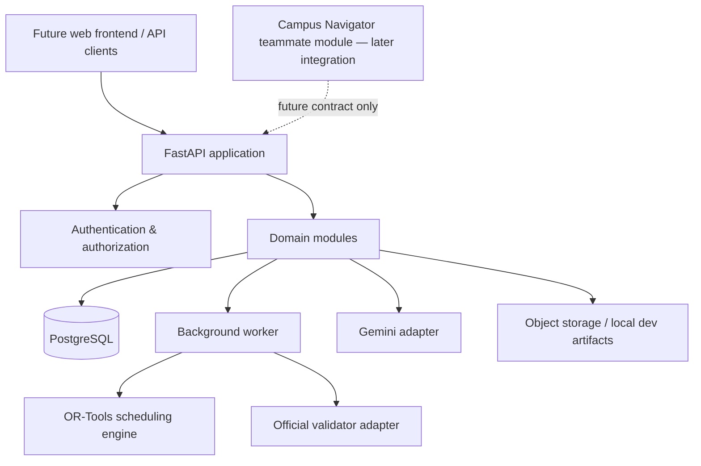

# CIT Campus Scheduling & Venue Management Platform
# Revised Database Blueprint v0.2

**Date:** 31 October 2026  
**Status:** Proposed engineering baseline — review required before migrations  
**Priority:** Database and fully functional backend first; frontend later  
**Campus Navigator:** Deferred; integration boundary only  
**Database:** PostgreSQL  
**Backend recommendation:** Python + FastAPI + SQLAlchemy 2.x + Alembic + Pydantic  
**Optimization:** Google OR-Tools CP-SAT  
**AI:** Gemini structured output / function calling, with deterministic backend validation

---

## 0. Executive architecture decision

Build a **database-first modular monolith**. One backend application and one PostgreSQL database, separated into domain modules and PostgreSQL schemas. Do not split into microservices for the hackathon. Do not allow the frontend or AI model to own business rules.

The product must be functionally usable through APIs, automated jobs and test scripts before UI work starts. “Backend complete” means a user or judge can execute the core workflows through documented APIs and the system can persist, validate, explain, export and recover the results.

Campus Navigator is **HOLD / INTEGRATION ONLY** in this blueprint. We will reserve a bounded module and API contract so the teammate's map work can be integrated later. We will not implement map upload, OCR, geometry extraction, routing, graph algorithms, PostGIS map data or map UI in this milestone.

### 0.1 Product workstreams in scope

1. Dataset import, validation, versioning and activation.
2. Academic master data and calendar configuration.
3. Weekly timetable generation and validation.
4. Timetable views and manual assignment operations.
5. Spectra/fest-week booking parsing, submission, prioritisation, decisions and allocations.
6. Fest-week timetable overrides for sessions displaced by approved institute events.
7. Midsem exam timetable generation and validation.
8. Disruption import, simulation, minimal-movement repair, approval and application.
9. Approval inbox, role permissions and audit history.
10. Analytics and operational summaries.
11. AI assistant for request interpretation and safe proposals.
12. Export generation and official validator integration.
13. Authentication, notifications, background jobs, observability and deployment.

### 0.2 Explicitly deferred

- Campus map ingestion, map editing, indoor/outdoor geometry, navigation graph and routing.
- Frontend UI/UX and visual design.
- Mobile application.
- Real-time GPS or indoor positioning.
- Multi-institute SaaS tenancy.
- Microservices and Kubernetes.
- Multi-room event booking unless organisers require it.
- Recurring booking engine until `series_id` semantics are confirmed.
- Payment, ticketing and attendance.

---

## 1. Source contract and verified starter-pack facts

The uploaded starter pack contains:
- `data/cit_public.json`
- `data/csv/*.csv`
- `validator.py`
- `README.md`
- `examples/schedule.example.json`
- `examples/sample_disruption.json`
- `examples/sample_requests.md`

The canonical JSON root keys are:

`dataset_id`, `institute`, `calendar`, `priority_order`, `role_category_cap`, `rooms`, `room_unavailability`, `faculty`, `student_groups`, `courses`, `sessions`, `booking_requests`, `cancellations`, `exams`.

Observed dataset counts: 27 rooms, 40 faculty, 14 student groups, 62 courses, 189 sessions, 25 booking requests, 1 cancellation, 41 exams. These are imported facts, never constants.

The starter-pack README says the judge resets the app, generates the timetable and applies their own change files. Never hardcode the current sample IDs or counts. The official validator is the machine acceptance authority. The exact source JSON is preserved as an immutable artifact for each import.

### 1.1 Source checksum for this reviewed fixture

`cit_public.json` SHA-256:
`8351362143097f1a0d80ce91f31bd1f2d77bd7e738f8701d48ad28fdf64ba8dd`

This checksum identifies the exact reviewed file. A future starter-pack update must produce a new import artifact and compatibility review; do not overwrite this record.

### 1.2 Authority and policy labels

- **SOURCE-CONFIRMED:** explicit in starter pack, problem statement or validator.
- **APPLICATION RULE:** additional protection implemented by the product; disclose it as such.
- **PROPOSED:** recommended engineering architecture.
- **OPEN:** needs organiser/team confirmation.
- **DEFERRED:** intentionally not implemented now.

---

## 2. System architecture



### 2.1 Modular monolith boundaries

One deployable FastAPI service initially, one worker process, one PostgreSQL database. Each module owns its tables and service functions. Cross-module writes go through application services, not ad hoc SQL from unrelated routers.

| Module | Owns |
|---|---|
| `identity` | Users, sessions, role assignments, scopes |
| `datasets` | Import artifacts, dataset versions, import reports |
| `academic` | Rooms, faculty, groups, courses, sessions, calendars |
| `scheduling` | Timetable versions, assignments, solver runs, validation |
| `booking` | Requests, windows, decisions, allocations, overrides |
| `exams` | Exam schedules, exam assignments, room allocations |
| `change_management` | Disruptions, proposals, diff, approval, apply |
| `approvals` | Approval tasks, events, routing policy |
| `analytics` | Read models and aggregate queries |
| `assistant` | Conversations, messages, tool calls, AI proposals |
| `notifications` | Notification delivery and read state |
| `exports` | Export snapshots, artifacts, validator results |
| `navigation` | Reserved integration boundary only; implementation deferred |

### 2.2 Technology recommendation

| Layer | Recommended choice | Why |
|---|---|---|
| API | FastAPI + Pydantic | Typed Python contracts and validation |
| Database | PostgreSQL | Transactions, constraints, relational integrity |
| ORM/migrations | SQLAlchemy 2.x + Alembic | Explicit schema evolution |
| Solver | OR-Tools CP-SAT | Constraint optimization |
| AI | Gemini structured output/function calling | Parse/assist, not authoritative decisions |
| Jobs | DB-backed job table + worker initially | Small-team simplicity; Redis optional |
| Tests | Pytest + official validator | Deterministic regression and competition compliance |
| API docs | OpenAPI generated by FastAPI | Frontend integration later |
| Frontend | React + TypeScript later | Independent client |

Payload CMS is not the default for this design. It may be reconsidered only if team implementation capability strongly favours TypeScript; the optimization engine still needs a Python boundary. Confirm team capability before freezing stack.

---

## 3. Database-wide design rules

### 3.1 IDs and source identity

- Internal primary keys: UUID.
- External identifiers from the starter pack: preserve exact strings (`F01`, `CR-102`, `MA101`, `BR-01`, etc.).
- Every imported entity belongs to an immutable `dataset_version_id`.
- Use `UNIQUE(dataset_version_id, external_id)`.
- Do not use display names as identifiers.
- Operational records reference internal UUIDs and the exact source/version they use.

### 3.2 Dataset version is the root

`core.dataset_versions` identifies one exact imported or derived institutional dataset. `external_dataset_id` such as `cit-public-v1` is not the internal primary key.

A dataset version stores:
- source dataset ID;
- version label;
- parent dataset version (nullable);
- source checksum;
- original filename and MIME type;
- immutable source JSON artifact reference;
- import schema version;
- app build/version;
- import status and report;
- imported by/at;
- activation status and timestamps;
- derivation metadata for approved permanent disruptions.

The original source dataset is never mutated. Applying a permanent disruption creates a derived dataset version with a parent pointer and applied change-set reference.

### 3.3 Immutable outputs

Once generated, validated, approved or published, timetable/exam/fest-week versions are not edited in place. Create a new version. Keep a separate pointer to the current published version. Rollback means changing the pointer to a prior immutable version and writing an audit event.

### 3.4 Time and timezone

- Store instants as `timestamptz`.
- Preserve submitted source timestamps as instants; optionally retain raw source string for exact audit.
- Store recurring calendar slots as day code + period/session identifier, not fabricated UTC timestamps.
- Institute timezone comes from the source/institution configuration. The reviewed fixture uses `+05:30`; do not hardcode this offset into every row.
- Teaching periods, event periods and exam sessions are distinct domain concepts.

### 3.5 JSONB rule

Use relational columns and join tables for queryable relationships and constraints. Use JSONB only for immutable source payloads, flexible change payloads, AI tool snapshots, validation report bodies and low-value metadata. Do not store the live application database as one large JSONB document.

---

## 4. Revised schema inventory

### 4.1 `core` — identity, institute, datasets and calendars

| Table | Key fields | Important rules |
|---|---|---|
| `institutes` | `id`, `code`, `name`, `timezone` | `code` unique |
| `departments` | `id`, `institute_id`, `code`, `name` | unique institute + code |
| `dataset_versions` | `id`, `external_dataset_id`, `parent_id`, `source_sha256`, `status`, `source_artifact_id` | immutable source identity; parent FK |
| `dataset_activations` | `id`, `dataset_version_id`, `activated_by`, `activated_at`, `deactivated_at` | history of active pointer |
| `calendar_versions` | `id`, `dataset_version_id`, `label`, `timezone` | one exact calendar per imported version |
| `calendar_days` | `id`, `calendar_version_id`, `day_code`, `ordinal`, `is_teaching_day` | unique calendar + day |
| `calendar_periods` | `id`, `calendar_version_id`, `period_number`, `start_time`, `end_time`, `is_teaching_period` | unique calendar + number |
| `calendar_breaks` | `id`, `calendar_version_id`, `break_code`, `after_period`, `start_time`, `end_time` | lunch and other breaks |
| `calendar_lab_start_periods` | `calendar_version_id`, `period_number` | FK to same calendar |
| `calendar_event_periods` | `calendar_version_id`, `period_number` | event-only periods |
| `calendar_exam_days` | `calendar_version_id`, `day_code`, `ordinal` | separate exam days |
| `calendar_exam_sessions` | `id`, `calendar_version_id`, `session_code`, `start_time`, `end_time` | AM/PM independent of teaching period |
| `users` | `id`, `email`, `display_name`, `auth_provider`, `status` | normalized email unique |
| `user_role_assignments` | `id`, `user_id`, `role_code`, `scope_type`, `scope_id` | official roles only; scoped grants |
| `auth_sessions` | `id`, `user_id`, `expires_at`, `revoked_at` | hashed refresh/session token only |
| `audit_events` | `id`, `actor_id`, `action`, `target_type`, `target_id`, `reason`, `before_ref`, `after_ref`, `correlation_id` | append-only |
| `source_artifacts` | `id`, `storage_key`, `sha256`, `size_bytes`, `mime_type` | immutable file metadata |
| `import_jobs` | `id`, `dataset_version_id`, `status`, `started_at`, `finished_at`, `report_json` | idempotent import |
| `system_settings` | `key`, `value_json`, `updated_by` | only non-secret settings |

The four official competition roles are `admin`, `department_coordinator`, `faculty`, and `club`. A club representative is the UI label for `club`, not a fifth role. A user may have more than one scoped role assignment if policy allows it. Student read access is a product decision, not a competition role.

### 4.2 `academic` — imported academic master data

| Table | Key fields | Relationships / constraints |
|---|---|---|
| `rooms` | `id`, `dataset_version_id`, `external_id`, `name`, `building`, `room_type`, `capacity`, `accessible` | unique dataset + external ID; capacity > 0 |
| `room_features` | `id`, `code`, `label` | stable feature dictionary |
| `room_feature_assignments` | `room_id`, `feature_id` | composite PK |
| `room_allowed_uses` | `room_id`, `use_code` | composite PK; lecture/tutorial/lab/exam/event |
| `faculty` | `id`, `dataset_version_id`, `external_id`, `name`, `department_id`, `max_hours_per_day`, `needs_accessible` | max hours > 0 |
| `student_groups` | `id`, `dataset_version_id`, `external_id`, `name`, `year`, `department_id`, `size`, `needs_accessible` | size > 0 |
| `courses` | `id`, `dataset_version_id`, `external_id`, `title`, `department_id`, `year`, `lecture_hours`, `tutorial_hours`, `lab_blocks` | source values preserved |
| `teaching_sessions` | `id`, `dataset_version_id`, `external_id`, `course_id`, `kind`, `faculty_id`, `size`, `duration_periods`, `needs_accessible`, `basket_slot`, `fixed_day`, `fixed_start_period` | unique dataset + external ID |
| `session_groups` | `session_id`, `student_group_id` | composite PK |
| `session_allowed_room_types` | `session_id`, `room_type` | composite PK |
| `faculty_unavailability` | `id`, `faculty_id`, `day_code`, `period_number`, `reason` | one row per unavailable period |
| `room_unavailability` | `id`, `room_id`, `day_code`, `period_number`, `reason` | one row per unavailable period |
| `faculty_preferences` | `id`, `faculty_id`, `preference_type`, `day_code`, `period_number`, `note`, `weight` | soft preference; do not confuse with unavailability |
| `booking_cancellations` | `id`, `dataset_version_id`, `external_request_id`, `cancelled_at`, `by_label`, `note` | cancellation source record |

Room type and allowed-use values must be validated against the source contract, but should not be hardcoded as only the currently observed rows. Unknown values fail import with a clear error until explicitly supported.

### 4.3 `scheduling` — weekly timetable

| Table | Key fields | Important rules |
|---|---|---|
| `timetable_versions` | `id`, `dataset_version_id`, `calendar_version_id`, `parent_version_id`, `status`, `version_number`, `created_by`, `published_at` | unique version number within dataset |
| `timetable_generation_requests` | `id`, `dataset_version_id`, `calendar_version_id`, `request_json`, `requested_by`, `idempotency_key` | captures generation intent |
| `solver_runs` | `id`, `generation_request_id`, `solver_name`, `solver_version`, `seed`, `time_limit_seconds`, `worker_count`, `objective_config_json`, `status`, `runtime_ms` | reproducibility |
| `timetable_assignments` | `id`, `timetable_version_id`, `session_id`, `day_code`, `start_period`, `room_id` | unique timetable + session |
| `timetable_occupancy` | `id`, `timetable_version_id`, `resource_type`, `resource_id`, `day_code`, `period_number`, `assignment_id`, `occupancy_key` | rebuildable concurrency/validation projection |
| `solver_metrics` | `id`, `solver_run_id`, `hard_violation_count`, `soft_s1`...`soft_s6`, `objective_value`, `metrics_json` | component totals |
| `validation_runs` | `id`, `target_type`, `target_version_id`, `validator_version`, `source_checksum`, `status`, `hard_count`, `soft_score`, `report_artifact_id` | immutable result |
| `validation_violations` | `id`, `validation_run_id`, `rule_code`, `severity`, `entity_type`, `entity_external_id`, `message`, `details_json` | queryable issue list |
| `timetable_publications` | `id`, `timetable_version_id`, `published_by`, `published_at`, `supersedes_id` | publication history |
| `timetable_manual_change_events` | `id`, `timetable_version_id`, `assignment_id`, `actor_id`, `reason`, `before_json`, `after_json` | manual edit audit |

`assignment_occupancy` is not authoritative data. It is derived from assignments and can be rebuilt. It exists to make clash detection and transactional checks reliable.

#### Basket occupancy design

For ordinary sessions, group occupancy is exclusive per group/day/period. For sessions with the same non-null `basket_slot`, the group occupancy key is shared as `basket:<basket_slot>` rather than the individual group ID, allowing the parallel elective sessions to coexist. The solver and validator must still ensure different rooms and identical day/start for the basket. Every other session for those groups conflicts with the basket.

Do not implement this as a simplistic unique index on `(group_id, day, period)` because that would incorrectly reject valid parallel electives. The application validator computes the correct occupancy key and the database stores it for the specific schedule version.

### 4.4 `booking` — Spectra / fest week

| Table | Key fields | Important rules |
|---|---|---|
| `booking_requests` | `id`, `dataset_version_id`, `external_id`, `submitted_at`, `requester_label`, `requester_role`, `department_id`, `requested_category`, `title`, `attendance`, `duration_periods`, `requested_room_id`, `series_id`, `raw_text` | immutable imported request |
| `booking_windows` | `id`, `booking_request_id`, `day_code`, `from_period`, `to_period` | `from_period <= to_period` |
| `booking_allowed_room_types` | `booking_request_id`, `room_type` | composite PK |
| `booking_required_features` | `booking_request_id`, `feature_code` | composite PK; `accessible` is a special requirement |
| `booking_mandatory_groups` | `booking_request_id`, `student_group_id` | composite PK |
| `booking_decisions` | `id`, `booking_request_id`, `decision_status`, `effective_category`, `reason`, `decided_by`, `decided_at`, `supersedes_decision_id` | exact export status values |
| `booking_allocations` | `id`, `booking_decision_id`, `room_id`, `day_code`, `start_period`, `end_period` | approved/alternative allocation; inclusive end |
| `booking_alternative_responses` | `id`, `booking_decision_id`, `response`, `responded_by`, `responded_at` | separate from exported decision status |
| `fest_week_versions` | `id`, `dataset_version_id`, `baseline_timetable_version_id`, `parent_version_id`, `status`, `version_number` | immutable fest-week plan |
| `fest_week_booking_decisions` | `fest_week_version_id`, `booking_decision_id` | plan membership |
| `session_overrides` | `id`, `fest_week_version_id`, `session_id`, `baseline_assignment_id`, `new_day`, `new_start_period`, `new_room_id`, `displaced_by_booking_decision_id`, `reason` | Week 7 only; never delete source session |
| `booking_approval_tasks` | `id`, `booking_request_id`, `assigned_role`, `assigned_scope`, `assigned_user_id`, `status`, `due_at` | reviewer workflow |
| `booking_approval_events` | `id`, `approval_task_id`, `actor_id`, `action`, `reason`, `created_at` | append-only |
| `booking_priority_evaluations` | `id`, `fest_week_version_id`, `booking_request_id`, `effective_category`, `category_weight`, `tie_break_timestamp`, `comparison_json` | explain decisions and inversions |

**Decision status values in export:** `approved`, `rejected`, `alternative_offered`. Do not replace these with generic workflow states. Alternative acceptance/decline is a separate response record; exact post-response export behaviour is OPEN pending organiser confirmation.

**Priority:** use `role_category_cap` from the imported dataset to cap the requested category. Use dataset `priority_order` for category ordering and earlier `submitted_at` for same-category tie. Persist the effective category and explanation used for each decision.

**Booking validation:** an approved allocation must fit wholly inside one requested window. An alternative offer may be outside the requested window and is half-scored by the official validator. Cancellations must never be approved. `requested_room` is a preference, not a hard requirement.

**Session overrides:** only an approved institute event may displace a regular session under the starter-pack contract. The session is moved, never dropped. The override is specific to the fest-week version and must reference its baseline assignment. It must not mutate the normal weekly timetable.

### 4.5 `exams` — midsem schedules

| Table | Key fields | Important rules |
|---|---|---|
| `exams` | `id`, `dataset_version_id`, `external_id`, `size`, `duration_hours` | source exam |
| `exam_courses` | `exam_id`, `course_id` | composite PK |
| `exam_groups` | `exam_id`, `student_group_id` | composite PK |
| `exam_schedule_versions` | `id`, `dataset_version_id`, `calendar_version_id`, `parent_version_id`, `status`, `version_number` | immutable |
| `exam_assignments` | `id`, `exam_schedule_version_id`, `exam_id`, `day_code`, `session_code` | unique version + exam |
| `exam_room_allocations` | `id`, `exam_assignment_id`, `room_id`, `allocated_capacity` | one exam may use multiple rooms |
| `exam_occupancy` | `id`, `exam_schedule_version_id`, `resource_type`, `resource_id`, `day_code`, `session_code`, `exam_assignment_id` | room and group clash projection |

Effective capacity is `floor(room.capacity / 2)` for each allocated room. Combined effective capacity must meet exam size. Preserve `duration_hours`; the official validator currently does not compare it against the AM/PM window duration. Do not silently introduce that as a validator rule.

### 4.6 `change_mgmt` — disruption and repair

| Table | Key fields | Important rules |
|---|---|---|
| `disruption_sets` | `id`, `source_artifact_id`, `status`, `imported_by`, `created_at` | one submitted change file |
| `disruption_changes` | `id`, `disruption_set_id`, `change_type`, `target_external_id`, `payload_json`, `reason` | preserve exact change payload |
| `change_proposals` | `id`, `disruption_set_id`, `baseline_dataset_version_id`, `target_dataset_version_id`, `baseline_timetable_version_id`, `proposed_timetable_version_id`, `status`, `movement_count`, `created_by` | stale baseline detection |
| `change_proposal_items` | `id`, `change_proposal_id`, `session_id`, `change_kind`, `before_assignment_json`, `after_assignment_json`, `explanation` | visible diff |
| `change_validations` | `id`, `change_proposal_id`, `validation_run_id`, `status` | validator result |
| `change_approvals` | `id`, `change_proposal_id`, `actor_id`, `decision`, `reason`, `created_at` | Admin approval |
| `applied_change_sets` | `id`, `change_proposal_id`, `derived_dataset_version_id`, `result_timetable_version_id`, `applied_by`, `applied_at` | atomic application |

Supported source change types: `faculty_unavailable`, `room_unavailable`, `add_faculty`, `add_session`, `remove_session`. Applying changes is permanent for future weeks according to README. A derived dataset version captures the permanent effect. A one-week fest-week session override is not a permanent disruption.

### 4.7 `approvals`, `notifications`, `analytics`, `assistant`, `integration`

| Schema/table | Core fields | Purpose |
|---|---|---|
| `approvals.approval_tasks` | target type/id, assigned role/scope/user, status, due date | common inbox task abstraction; domain-specific task tables may link to it |
| `approvals.approval_events` | task, actor, action, reason, timestamp | immutable decision history |
| `notifications.notifications` | recipient, type, title, body, target, created_at, read_at | in-app notification |
| `analytics.metric_snapshots` | dataset/timetable/fest version, metric key, value, dimensions, computed_at | optional cached metrics |
| `assistant.conversations` | user, title, created_at, updated_at | assistant history |
| `assistant.messages` | conversation, role, content, structured_payload, created_at | prompt/response record |
| `assistant.tool_executions` | message, tool_name, input_json, output_json, status, validation_run_id | trace every tool action |
| `integration.export_jobs` | dataset/timetable/fest/exam version IDs, status, checksum, artifact_id | reproducible export |
| `integration.validator_runs` | export_job, validator_version, command/config, report_artifact_id, result | official validator |
| `integration.import_mappings` | source_path, target_table, target_field, transform_name, required | auditable source mapping |
| `integration.background_jobs` | job_type, payload, status, attempts, available_at, locked_at, result_json | DB-backed worker queue |

Analytics can initially be computed directly from normalized tables. Add metric snapshots only for expensive or repeat-heavy reports. Do not store derived metrics as the source of truth.

---

## 5. Source JSON to relational mapping

| JSON root / field | Relational target | Transformation |
|---|---|---|
| `dataset_id` | `core.dataset_versions.external_dataset_id` | preserve exact value |
| `institute` | `core.institutes.name` | match/create institute |
| `calendar.days` | `core.calendar_days` | one row per day |
| `calendar.periods[]` | `core.calendar_periods` | one row per period |
| `calendar.lunch` | `core.calendar_breaks` | one lunch break |
| `calendar.lab_start_periods[]` | `core.calendar_lab_start_periods` | one row per period |
| `calendar.event_only_periods[]` | `core.calendar_event_periods` | one row per period |
| `calendar.exam_week.days[]` | `core.calendar_exam_days` | separate exam day rows |
| `calendar.exam_week.sessions[]` | `core.calendar_exam_sessions` | AM/PM rows |
| `priority_order[]` | `core.dataset_policy` or dataset JSON policy | preserve order, never sort alphabetically |
| `role_category_cap` | `core.dataset_role_category_caps` | role → maximum category |
| `rooms[]` | `academic.rooms` | features/allowed_uses to join tables |
| `room_unavailability[]` | `academic.room_unavailability` | expand periods to rows |
| `faculty[]` | `academic.faculty` | unavailability/preferences to child tables |
| `student_groups[]` | `academic.student_groups` | preserve size/year/department |
| `courses[]` | `academic.courses` | preserve hours and lab blocks |
| `sessions[]` | `academic.teaching_sessions` | groups and room types to join tables |
| `booking_requests[]` | `booking.booking_requests` | windows/needs/groups to child tables |
| `cancellations[]` | `booking.booking_cancellations` | keep cancellation separate from request |
| `exams[]` | `exams.exams` | courses/groups to join tables |

Import must be atomic: parse and validate the complete file first; create an `import_job`; insert a new dataset version and all children in one transaction; on any failure roll back the new version and persist a failed import report outside the failed transaction. Never partially activate an import.

### 5.1 CSV handling

JSON is canonical. CSV files are supporting inspection material. The CSVs do not carry every root-level configuration field. Do not reconstruct calendar, priority order or role caps from CSV. If both JSON and CSV are uploaded, JSON wins and CSV is treated as an optional consistency cross-check.

---

## 6. Database constraints and indexes

### 6.1 Must-have constraints

- Every imported entity: FK to dataset version; unique `(dataset_version_id, external_id)`.
- `rooms.capacity > 0`; `student_groups.size > 0`; `sessions.duration_periods > 0`; `booking.attendance > 0`.
- Session kind in supported values; booking status in exact export values.
- `from_period <= to_period`; assignment day/period must exist in referenced calendar version.
- Unique `(timetable_version_id, session_id)`.
- Unique `(exam_schedule_version_id, exam_id)`.
- Unique `(booking_request_id, effective_decision_sequence)` or a single effective-decision pointer.
- No duplicate session-group, room-feature, room-use or session-room-type relationship.
- Foreign keys must ensure referenced entities belong to the same dataset version.
- Published versions cannot be mutated by ordinary update endpoints.
- All writes to published pointer rows occur transactionally and are audited.

### 6.2 Indexes

- All foreign keys.
- `dataset_versions(external_dataset_id, created_at desc)`.
- Imported external ID indexes on `(dataset_version_id, external_id)`.
- Timetable assignment `(timetable_version_id, day_code, start_period)`, `(timetable_version_id, room_id, day_code, start_period)`.
- Occupancy `(timetable_version_id, resource_type, resource_id, day_code, period_number)`.
- Booking `(dataset_version_id, submitted_at)`, `(decision_status, decided_at)`, `(requester_role, requested_category)`.
- Booking allocation `(room_id, day_code, start_period, end_period)`.
- Approval inbox `(assigned_user_id, status, created_at)`, `(assigned_role, assigned_scope, status)`.
- Exam assignment `(exam_schedule_version_id, day_code, session_code)`.
- Notifications `(recipient_user_id, read_at, created_at desc)`.
- Audit `(target_type, target_id, created_at desc)`, `(actor_id, created_at desc)`.
- Background jobs `(status, available_at)`.

### 6.3 Exclusion constraints and concurrency

PostgreSQL exclusion constraints may be useful for room/time overlap if periods are represented as integer ranges, but they do not fully solve faculty/group and elective-basket semantics. For MVP, use:
1. version-scoped occupancy rows;
2. transaction-level locks for resources being modified;
3. unique/exclusion constraints where the representation is sound;
4. deterministic domain validation inside the same transaction.

A “check then insert” outside one transaction is not safe.

---

## 7. Functional backend requirements — no fake endpoints

A feature is **implemented** only when its API, domain service, persistence, authorization, validation, error cases and automated tests exist.

| Capability | Backend behaviour required | Acceptance evidence |
|---|---|---|
| Authentication | login/session refresh/logout; hashed tokens; account status | auth tests; expired/revoked token rejected |
| Authorization | four roles + scope checks; no self-approval | role matrix tests |
| Dataset import | validate JSON, map all fields, atomic import, counts/report | fixture import equals source counts |
| Dataset activation | exact version pointer; audit | activation and rollback tests |
| Timetable generation | solve all sessions; persist assignments and solver run | complete assignment count; validator pass |
| Timetable validation | run hard/soft checks and official validator adapter | golden fixture reports |
| Manual assignment | validate before save; conflict details; optimistic version check | invalid change rejected atomically |
| Timetable views | group/faculty/room queries from same assignments | response consistency tests |
| Booking parse | natural language → structured draft only | parser fixtures; no automatic submission |
| Booking submit | persist request and windows; permissions and audit | create/read tests |
| Booking decision | role cap, priority, room/time/group checks, reason | decision rule tests |
| Alternative response | accept/decline separate lifecycle | response state tests; export semantics open |
| Session override | approved institute event only; move not drop; baseline reference | export round-trip and validator |
| Exam generation | allocate all exams across one or more rooms | exam validator pass |
| Disruption import | parse exact supported change types | schema fixtures |
| Disruption repair | derive dataset, solve with movement objective, show diff | baseline comparison tests |
| Disruption apply | Admin approval; stale version check; atomic activation | rollback and concurrency tests |
| Approvals | inbox, task actions, reason, no-self-approval | workflow tests |
| Analytics | utilization, conflicts, pending approvals, scorecards | aggregation tests |
| AI assistant | narrow tools; draft proposals; deterministic validation | tool allowlist and injection tests |
| Exports | generate JSON from DB, run official validator, persist artifact | exact schema and checksum tests |
| Notifications | create and read state for important workflow events | notification tests |
| Audit | immutable record for consequential writes | audit completeness tests |

### 7.1 Timetable solver acceptance

Hard constraints must be zero:
- every source session appears exactly once;
- no faculty clash;
- no group clash, respecting elective basket semantics;
- no room clash;
- room capacity and allowed type;
- faculty/room unavailability;
- teaching periods, lunch and lab start restrictions;
- accessibility;
- basket day/start equality;
- faculty daily maximum;
- fixed slots preserved.

Soft penalties must match the official validator S1–S6. Persist component values and explain each penalty. Do not report “optimal” if solver stopped at feasible/time limit. Distinguish `OPTIMAL`, `FEASIBLE`, `INFEASIBLE`, `UNKNOWN`, `TIME_LIMIT`, `FAILED`.

### 7.2 Booking engine acceptance

- Effective category is capped by role from dataset configuration.
- Priority order comes from dataset configuration.
- Earlier `submitted_at` wins same-category ties.
- Cancelled request cannot be approved or offered an alternative.
- Requested room is a preference.
- Approved allocation fits fully inside one request window.
- Alternative offer may be outside window and is half-scored.
- Room use, room type, capacity, features, room unavailability and timetable conflicts are checked.
- Only an approved institute event may displace a regular session; override moves the session and references `displaced_by`.
- Record decision reason and priority explanation.
- Application should require complete decisions before export readiness even though the validator reports missing decisions as warnings.

### 7.3 Exam engine acceptance

- Each exam scheduled exactly once.
- Valid exam day and AM/PM slot.
- Room allows exam use.
- Half-capacity rule per room.
- Multi-room allocation supported.
- No room or group clash.
- Same-day group exam penalty reported.
- Preserve source `duration_hours`; do not add stricter duration matching without organiser confirmation.

### 7.4 Disruption repair acceptance

- Supported changes: faculty unavailable, room unavailable, add faculty, add session, remove session.
- Preserve original dataset version.
- Create derived dataset version.
- Solve against explicit baseline timetable version.
- Minimize moved sessions after satisfying hard constraints (lexicographic or weighted objective documented).
- Show before/after for each changed session.
- Explain infeasibility and unsatisfied constraints where solver supports it.
- Require Admin approval before apply.
- Revalidate baseline hasn't changed before apply.
- Apply dataset and timetable pointers atomically.
- Permanent change applies to future weeks; keep historical versions.

---

## 8. API design principles

Base path: `/api/v1`.

### 8.1 Response and errors

Use a consistent response envelope:
- success: `data`, optional `meta`, `request_id`;
- error: `error.code`, `error.message`, `error.details`, `request_id`.

Use HTTP status codes correctly: 400 malformed request, 401 unauthenticated, 403 unauthorized, 404 missing, 409 conflict/stale version, 422 domain validation failure, 429 rate limited, 500 unexpected server error.

### 8.2 Version and idempotency headers

- `Idempotency-Key`: import, generation, export, apply and other retryable job creation.
- `If-Match`: editing a known version or activating a proposal against a baseline.
- Return job IDs for long-running operations. A job response means “accepted/queued”, not “completed”.

### 8.3 Core endpoint inventory

**Identity**
- `POST /auth/login`
- `POST /auth/refresh`
- `POST /auth/logout`
- `GET /auth/me`

**Datasets**
- `POST /datasets/import`
- `GET /datasets`
- `GET /datasets/{dataset_version_id}`
- `GET /datasets/{dataset_version_id}/import-report`
- `POST /datasets/{dataset_version_id}/activate`

**Academic**
- `GET /academic/rooms`
- `GET /academic/faculty`
- `GET /academic/student-groups`
- `GET /academic/courses`
- `GET /academic/sessions`
- `GET /academic/calendar`

**Timetables**
- `POST /timetables/generate`
- `GET /timetables`
- `GET /timetables/{id}`
- `GET /timetables/{id}/group/{group_id}`
- `GET /timetables/{id}/faculty/{faculty_id}`
- `GET /timetables/{id}/room/{room_id}`
- `POST /timetables/{id}/validate`
- `POST /timetables/{id}/assignments`
- `PATCH /timetables/{id}/assignments/{assignment_id}`
- `POST /timetables/{id}/approve`
- `POST /timetables/{id}/publish`

**Bookings / fest week**
- `POST /booking-requests/parse`
- `POST /booking-requests`
- `GET /booking-requests`
- `GET /booking-requests/{id}`
- `POST /booking-requests/{id}/submit`
- `POST /booking-requests/{id}/cancel`
- `POST /booking-requests/{id}/decisions`
- `POST /booking-decisions/{id}/alternative-response`
- `GET /fest-week-versions`
- `POST /fest-week-versions`
- `GET /fest-week-versions/{id}`
- `POST /fest-week-versions/{id}/session-overrides`
- `POST /fest-week-versions/{id}/validate`

**Approvals**
- `GET /approvals/inbox`
- `GET /approvals/{task_id}`
- `POST /approvals/{task_id}/approve`
- `POST /approvals/{task_id}/reject`
- `POST /approvals/{task_id}/request-changes`

**Exams**
- `POST /exam-schedules/generate`
- `GET /exam-schedules`
- `GET /exam-schedules/{id}`
- `POST /exam-schedules/{id}/validate`
- `POST /exam-schedules/{id}/approve`
- `POST /exam-schedules/{id}/publish`

**Disruptions**
- `POST /disruptions/import`
- `POST /change-proposals`
- `GET /change-proposals/{id}`
- `GET /change-proposals/{id}/diff`
- `POST /change-proposals/{id}/validate`
- `POST /change-proposals/{id}/approve`
- `POST /change-proposals/{id}/apply`

**Analytics**
- `GET /analytics/overview`
- `GET /analytics/room-utilisation`
- `GET /analytics/conflicts`
- `GET /analytics/booking-summary`
- `GET /analytics/timetable-quality`

**AI**
- `POST /assistant/conversations`
- `GET /assistant/conversations/{id}`
- `POST /assistant/conversations/{id}/messages`
- `GET /assistant/tool-executions/{id}`

**Exports / jobs / notifications / audit**
- `POST /exports/schedule`
- `POST /exports/schedule-after`
- `GET /exports/{id}`
- `GET /jobs/{id}`
- `GET /notifications`
- `POST /notifications/{id}/read`
- `GET /audit-events`

**Navigator — reserved, not implemented in this milestone**
- reserve namespace `/navigation/*` only after teammate contract is agreed. No fake routes that return placeholder success.

---

## 9. AI boundary and safety architecture

AI is an interface and interpretation layer, not the authority.

Allowed AI operations:
- parse plain English/Hinglish request into a typed booking draft;
- ask clarifying questions for missing/ambiguous date, time, duration, attendance, venue or requirements;
- explain a validator result using stored evidence;
- propose timetable or disruption changes through typed commands;
- summarize schedule and availability data fetched by authorized backend tools.

Forbidden:
- direct SQL;
- arbitrary database writes;
- direct booking approval;
- direct timetable publication;
- direct disruption application;
- bypassing role permissions;
- inventing room availability;
- claiming a solver result without a completed solver job.

Every tool call is allowlisted, schema-validated, permission-checked and logged. Every proposed schedule/booking/change is revalidated by deterministic code. The final consequential action requires an authorized user and transactional service.

---

## 10. Transactions, locks and race conditions

### 10.1 Booking allocation transaction

1. Begin transaction.
2. Lock relevant room/day/period occupancy keys in stable sorted order.
3. Lock/check mandatory student-group/day/period occupancy keys.
4. Re-check timetable and room unavailability using the exact active versions.
5. Validate room capacity, type, allowed use and features.
6. Insert decision and allocation rows.
7. Update occupancy projection.
8. Append approval/audit events.
9. Commit.

If any check fails, roll back all writes. Never leave a decision without its intended allocation.

### 10.2 Manual timetable edit transaction

1. Require expected timetable version/ETag.
2. Lock timetable version and relevant resource occupancy.
3. Validate assignment and all affected occupied periods.
4. Apply edit to a draft/new version (not a published version).
5. Rebuild affected occupancy rows.
6. Run validation or mark version `NEEDS_VALIDATION`.
7. Append audit event and commit.

### 10.3 Publish transaction

1. Lock publication pointer.
2. Verify version is validated and approved.
3. Verify source dataset/calendar references still match.
4. Update current published pointer.
5. Append publication and audit event.
6. Commit.

### 10.4 Disruption apply transaction

1. Lock active dataset/timetable pointers.
2. Confirm proposal baseline IDs match active IDs.
3. Confirm Admin approval and successful validation.
4. Activate derived dataset and result timetable together.
5. Record applied change set and audit event.
6. Commit atomically.

---

## 11. Background jobs and operational reliability

Use `integration.background_jobs` for long-running solver/import/export tasks. A worker claims jobs with row locking (`FOR UPDATE SKIP LOCKED`), records attempt count and lease/lock time, and marks success/failure. Jobs must be idempotent or guarded by idempotency keys.

Job types:
- `dataset_import`
- `timetable_generation`
- `timetable_validation`
- `booking_priority_evaluation`
- `exam_generation`
- `disruption_repair`
- `official_validator`
- `schedule_export`

A job has queued/running/succeeded/failed/cancelled states. Persist structured errors and safe retry policy. Do not retry deterministic invalid-input jobs endlessly.

For the hackathon, a separate worker process with PostgreSQL job table is enough. Redis/Celery can be added if queue throughput or multiple workers require it.

---

## 12. Import/export contract and golden tests

### 12.1 Import

- Validate root keys and nested types with strict Pydantic models.
- Reject missing required fields, invalid references, duplicate external IDs, unknown enum values and invalid periods.
- Record source SHA-256.
- Parse timestamps with timezone offsets.
- Normalize arrays into relationship rows.
- Expand period arrays in unavailability into one row per period.
- Preserve raw source JSON.
- Import transactionally.
- Generate row counts and warnings.
- Never hardcode counts.

### 12.2 Export

Generate these files from persisted database state:
- `exports/schedule.json`
- `exports/schedule_after.json`

Do not hand-edit. The export adapter must include exact fields:
- `team`
- `dataset_id`
- `sessions`
- `fest_week.bookings`
- `fest_week.session_overrides`
- `exams` (required for schedule.json; optional for schedule_after.json per README)

Preserve exact exported status strings and inclusive `end_period`. Session overrides are Week 7 only and must reference the approved institute booking that displaced the session.

### 12.3 Golden acceptance suite

- Import starter JSON and compare all source record counts and IDs.
- Validate sample schedule fixture format.
- Test one fixture per hard validator rule.
- Test all soft penalty components S1–S6.
- Test booking priority caps, ties, cancellation, alternative and missing decision.
- Test exam multi-room half-capacity and clashes.
- Test each supported disruption type.
- Generate `schedule.json`, run official validator, retain report.
- Apply sample disruption, generate `schedule_after.json`, run official validator with baseline and disruption.
- Test export JSON schema and deterministic serialization.
- Test import idempotency and failed import rollback.

---

## 13. Security, privacy and audit

- Passwords are never stored in plaintext; use a mature password hashing function if local passwords are enabled. Prefer OAuth/OIDC if available and stable.
- Refresh tokens are hashed at rest; revoke on logout/rotation.
- Role checks happen in backend service dependencies, not UI only.
- Scope checks apply to department/club/resource actions.
- No self-approval.
- Do not trust requester role/category from client payload; derive or verify from authenticated role assignment, while preserving source imported labels for competition fixture.
- Rate limit authentication and AI endpoints.
- Validate file type, size and content; store files outside public web root.
- Secrets only in environment/secret manager, never in source or audit payloads.
- Audit consequential actions with actor, target, reason, before/after references, correlation ID and version IDs.
- Avoid storing unnecessary personal data in AI transcripts and logs.
- Restrict audit endpoints to authorized roles.

---

## 14. Observability and deployment

Minimum production-like readiness:
- structured logs with request/correlation ID;
- health endpoint and readiness endpoint;
- database connectivity check;
- worker heartbeat and failed-job view;
- error monitoring;
- migration status check;
- backup and restore test;
- environment separation (`local`, `staging`, `production`);
- CORS restricted to known frontend origins;
- TLS in deployment;
- no production secrets committed.

Suggested deployment:
- Frontend later: Vercel or static host.
- FastAPI: managed Python app/container host.
- PostgreSQL: managed PostgreSQL.
- Worker: separate process on same deployment platform.
- File artifacts: object storage; local filesystem only for development.
- PostGIS extension: **not required for this milestone**; add only when map teammate's integration needs it.

---

## 15. Repository layout

```text
cit-platform/
  backend/
    app/
      main.py
      api/
        v1/
          routers/
      core/
        config.py
        database.py
        security.py
        permissions.py
        errors.py
      modules/
        identity/
        datasets/
        academic/
        scheduling/
        booking/
        exams/
        change_management/
        approvals/
        analytics/
        assistant/
        notifications/
        exports/
        navigation_contract/   # interface/types only; map implementation deferred
      workers/
      shared/
    migrations/
    tests/
      unit/
      integration/
      contract/
      golden/
    pyproject.toml
  contracts/
    openapi/
    json-schemas/
  data/
    fixtures/
  exports/
  docs/
    product/
    architecture/
    database/
    api/
    operations/
  scripts/
  .env.example
  README.md
```

Keep domain services separate from routers. Routers should parse requests, authenticate, call a service and serialize responses. They should not contain solver or priority logic.

---

## 16. Implementation plan — backend first, frontend last

### Stage 1 — Freeze contracts
- Review this blueprint.
- Confirm Python/TypeScript team capability.
- Resolve or explicitly defer open policy questions.
- Approve source mapping and export contract.

### Stage 2 — Database foundation
- PostgreSQL local environment.
- SQLAlchemy models and Alembic initial migrations.
- Core, academic, identity, audit and integration tables.
- Import and migration tests.

### Stage 3 — Import + read APIs
- Strict source parser.
- Atomic dataset import.
- Academic read APIs.
- Dataset activation and version audit.

### Stage 4 — Timetable engine
- Hard validator.
- OR-Tools model.
- Solver job worker.
- Timetable persistence, metrics and group/faculty/room read APIs.
- Manual edits and publish flow.

### Stage 5 — Booking engine
- Request parser draft endpoint.
- Booking persistence and cancellation.
- Priority engine and allocation.
- Approval workflow.
- Fest-week versions and session overrides.

### Stage 6 — Exams
- Exam model, solver, room allocation and validator.
- Exam publication.

### Stage 7 — Disruption repair
- Change import.
- Derived dataset version.
- Minimal movement objective.
- Proposal diff and approval.
- Atomic apply and export.

### Stage 8 — AI + analytics + notifications
- Tool allowlist.
- Structured outputs.
- Deterministic validation.
- Analytics and notifications.
- Audit search.

### Stage 9 — Export and deployment hardening
- Official validator on both required exports.
- Golden test suite.
- Load/concurrency tests.
- Backups, health checks, logs, docs.
- Integration handoff contract for map teammate.

### Stage 10 — Frontend integration
Only after the backend passes its acceptance gates. Build the frontend against OpenAPI and stable response contracts. UI does not redefine database or business rules.

---

## 17. Open decisions that must remain visible

| ID | Decision | Default / recommendation |
|---|---|---|
| D-01 | Team confidence with Python/FastAPI | Confirm before stack freeze |
| D-02 | Booking reviewer routing | Admin-managed scoped routing |
| D-03 | Multiple approval stages | Schema supports; MVP one stage unless required |
| D-04 | Alternative accepted/declined export semantics | Store response separately; ask organiser |
| D-05 | Event-only booking period restriction | Validator does not enforce; treat stricter rule as application policy only if approved |
| D-06 | Booking-to-booking mandatory group conflicts | Add application-level protection |
| D-07 | Manual timetable edit permissions | Scoped role permissions; Admin publication |
| D-08 | Timetable publication approval | Admin gate recommended |
| D-09 | Student read-only access | Product policy; not a fifth competition role |
| D-10 | `series_id` recurrence semantics | Preserve source field; defer recurrence engine |
| D-11 | Complete booking decisions for export | Require all decisions for app export readiness |
| D-12 | Exam duration matching AM/PM | Preserve field; no extra rule until organiser confirms |
| D-13 | Map teammate API/data contract | Obtain from teammate before integration; map work held |
| D-14 | Hosting provider and auth provider | Choose after team access/cost review |

---

## 18. Definition of backend/database completion

We do not call the backend “finished” just because the server starts or Swagger shows endpoints.

The backend/database package is ready for frontend integration only when:

- [ ] All migrations apply cleanly on a fresh database.
- [ ] A backup can be restored successfully.
- [ ] Starter JSON imports atomically and source IDs/counts match.
- [ ] Dataset version activation and history work.
- [ ] Timetable generation returns a persisted schedule and solver provenance.
- [ ] Timetable passes official hard validation.
- [ ] All S1–S6 penalties are computed and explained.
- [ ] Manual assignment edits reject conflicts and preserve version history.
- [ ] Group/faculty/room views return consistent data.
- [ ] Booking requests can be parsed into editable drafts and submitted.
- [ ] Booking priority, cancellation and room allocation rules are tested.
- [ ] Approval actions are scoped, audited and prevent self-approval.
- [ ] Fest-week session overrides are persisted and exported.
- [ ] Exams schedule every exam with valid multi-room allocations.
- [ ] Sample disruption produces a derived dataset and repaired schedule.
- [ ] Repair minimizes movement subject to hard constraints.
- [ ] Admin approval and atomic apply work.
- [ ] AI cannot bypass permissions or deterministic validation.
- [ ] Analytics, notifications and audit endpoints work.
- [ ] Both exports are generated from database state and pass the official validator.
- [ ] OpenAPI is stable and versioned for frontend integration.
- [ ] Automated unit, integration, contract and golden tests pass.
- [ ] Map integration boundary is documented without implementing map functionality.

**Current status:** This is the revised proposed blueprint. It is not yet deployed and does not claim that code or migrations have been implemented. The next engineering action is to review/approve this schema, then generate the actual SQLAlchemy models and Alembic migrations.

---

## 19. Immediate next milestone

**Milestone 2E — Database DDL, SQLAlchemy model plan and migration specification.**

Deliver:
1. PostgreSQL DDL for the approved tables, keys, checks and indexes.
2. SQLAlchemy 2.x model definitions and relationship plan.
3. Alembic migration order and downgrade strategy.
4. Seed/import transaction design.
5. Test database fixtures and schema acceptance tests.
6. No map implementation.
7. No frontend implementation yet.

After that, begin actual backend implementation with the database foundation and import pipeline. Continue through each functional module until the backend passes the completion checklist, then move to frontend integration.
